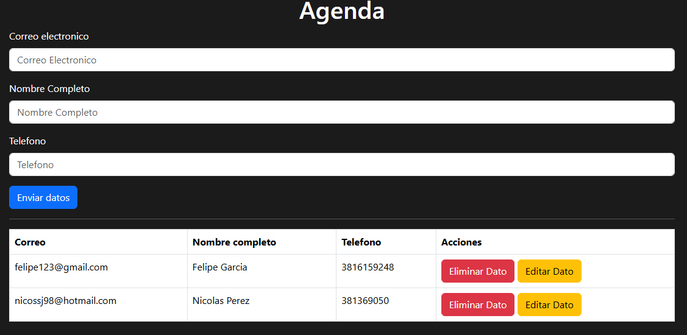

# Contact Management App

A simple contact management application built with JavaScript, HTML, and CSS. It allows users to manage their personal contacts through an intuitive interface.

## Features

- **Create contacts:** Add new contacts with a name, email address, and phone number.
- **View contacts:** Display the registered contacts.
- **Edit contacts:** Update existing contact information.
- **Delete contacts:** Remove contacts from the list.
- **Form validation:** Validate user input before saving contact information.
- **Data persistence:** Store contacts in the browser using the Local Storage API, so data remains available after refreshing the page.

## Technologies Used

- HTML5
- CSS3
- JavaScript
- Bootstrap 5
- Local Storage API

## Screenshot



## Getting Started

### Run Locally

1. Clone the repository:

   ```bash
   git clone https://github.com/Facundo-Reynoso/contact-management-app.git
   ```

2. Open the project folder.

3. Open `index.html` in your browser.

No additional dependencies or backend configuration are required.

## Project Structure

```text
contact-management-app/
│
├── assets/
│   └── crud-screenshot.png
│
├── index.html
├── main.js
├── styles.css
└── README.md
```

## About

This project was developed as a personal practice project to strengthen my JavaScript skills and apply fundamental web development concepts, including DOM manipulation, CRUD operations, form validation, and browser storage.
